# Build, Start & Stop Script Separation Architecture

This document details the architectural mechanics, lifecycle phases, PID tracking protocol, and zero-assumption environment verification for Windows (`.ps1`) and Linux (`.sh`).

---

## 1. Why Start Must Run in Optimized Production Mode (Never Dev Mode)

In many full-stack setups, developers default to running development servers (`npm run dev`, `cargo run`, `flutter run`). In real-world applications, this severely degrades startup speed and runtime performance:

### The Flaws of Development Mode:
1. **Dynamic Transpilation Lag (The "Blank Screen" Problem)**:
   - Dev bundlers compile modules on demand as the browser requests them, causing a 5 to 15 second blank white screen on initial load.
2. **Unoptimized Execution (Debug Profile)**:
   - `cargo run` defaults to `opt-level = 0` with zero SIMD vectorization or inlining (running 20x–100x slower on compute workloads).
   - `flutter run` (debug) runs inside a JIT VM with checked assertions, causing frame drops on 120Hz displays.
3. **Orphaned Background Processes & File Locks**:
   - Without deterministic PID tracking (`.pids`) and a dedicated `stop` script, background processes linger on ports and lock `.exe` files on Windows (`OS Error 5: Access is denied`).

---

## 2. Three-Script Lifecycle Flow (`build` / `start` / `stop`)

```mermaid
flowchart TD
    subgraph BuildPhase ["1. Zero-Assumption Build (build.ps1 / build.sh)"]
        direction TB
        B0["Phase 0: Extensive Toolchain Checklist (Git, C/C++ Linker, Rust, Node, pnpm, JDK/Flutter)"]
        B0_Install{"Missing Tool Auto-Installable?"}
        B0_Auto["Auto-Install via winget / rustup / corepack / apt"]
        B0_Fail["Throw Actionable Error with Download URL & Command"]
        B1["Phase 1: Invoke stop.ps1 / stop.sh (Unlock Running Binaries)"]
        B2["Phase 2: Install Dependencies & Bundle Frontend (pnpm build -> dist/)"]
        B3["Phase 3: Compile Release Backend (cargo build --release)"]
        B4["Phase 4: Verify Production Artifacts Ready (Exit 0)"]

        B0 --> B0_Install
        B0_Install -- "Yes" --> B0_Auto --> B1
        B0_Install -- "No / Failed" --> B0_Fail
        B0_Install -- "All Present" --> B1
        B1 --> B2 --> B3 --> B4
    end

    subgraph StartPhase ["2. Production Runner (start.ps1 / start.sh)"]
        direction TB
        S0["1. Invoke stop.ps1 / stop.sh --quiet (Clean Slate)"]
        S1{"2. Artifacts Exist?"}
        S1_Build["Fallback: Run build.ps1 / build.sh"]
        S1_Log["3. Boot Logger & Shipper FIRST (VictoriaLogs 9428 + ship-logs.ps1)"]
        S2["4. Spawn Release Binary & Direct node.exe Preview (Redirect Stdin/Out/Err -> .logs/)"]
        S3["5. Write Logger, Shipper, Backend & Frontend PIDs to .pids"]
        S4["6. 100ms Health Polling (-DisableKeepAlive) -> Exit 0 Detached (or Stream if -Foreground)"]

        S0 --> S1
        S1 -- "No" --> S1_Build --> S1_Log
        S1 -- "Yes" --> S1_Log
        S1_Log --> S2 --> S3 --> S4
    end

    subgraph StopPhase ["3. Deterministic PID Stopper (stop.ps1 / stop.sh)"]
        direction TB
        K0["1. Read logger/shipper/app PIDs from .pids"]
        K1["2. Terminate App Trees & Sweep App Ports (Exclude 9428)"]
        K2["3. Poll & Confirm ALL App PIDs & Ports Dead"]
        K3["4. Flush Shipper (.stop-shipper -> .shipper-flushed)"]
        K4["5. Stop VictoriaLogs LAST (unless -KeepLogger) & Delete .pids"]

        K0 --> K1 --> K2 --> K3 --> K4
    end

    BuildPhase -.->|"Produces artifacts"| StartPhase
    StartPhase -.->|"Writes .pids"| StopPhase
```



---

## 3. Detached-by-Default Execution & Deterministic PID Tracking (`.pids`)

`start.ps1` (Windows) and `start.sh` (Linux/macOS) **default to detached mode** and return immediately after readiness probing (`exit 0`); callers pass `-Foreground` (`--foreground` / `-f` on Linux) only when interactive log tailing with `Ctrl+C` teardown is desired.

To guarantee Windows PowerShell / CI / agent shells never hang waiting on open child stdio handles after `start.ps1` exits:
1. **Redirect Standard Input on Every Hidden Process:** Pre-create empty zero-byte `.stdin` files in `.logs\` (`.vl.stdin`, `.ship.stdin`, `.back.stdin`, `.front.stdin`) and pass `-RedirectStandardInput` alongside `-RedirectStandardOutput` and `-RedirectStandardError` on every `Start-Process -WindowStyle Hidden` call (including `powershell.exe -NonInteractive` for `ship-logs.ps1`). Otherwise Windows inherits the caller's stdin pipe handle into the daemon tree.
2. **Bypass `cmd.exe` / `pnpm.cmd` Console Wrappers:** Launch `node.exe` directly against `frontend/node_modules/vite/bin/vite.js` (`preview --port <P> --host`) rather than invoking `pnpm.cmd run preview`. This prevents `cmd.exe` shim pipe inheritance and ensures `.pids.frontend_pid` points to the actual `node.exe` process.
3. **Close Probe Connections Promptly:** Pass `-DisableKeepAlive` to `Invoke-WebRequest` readiness checks so pooled TCP sockets do not linger across process exit.

When `start.ps1` or `start.sh` launches the application:
1. On Windows (`start.ps1`), it boots `VictoriaLogs` (`127.0.0.1:9428`) and `ship-logs.ps1` **first**, before launching the application processes.
2. It captures the OS process ID (`PID`) of the logger, shipper, compiled backend binary, and frontend preview server.
3. It writes those PIDs to `<repo-root>/.pids`:
   - On Windows (`start.ps1`): JSON structure containing `logger_pid`, `logger_owned`, `logger_port`, `shipper_pid`, `backend_pid`, `frontend_pid`, `backend_port`, `frontend_port`, `stop_sentinel`, `flushed_sentinel`, `started_at`.
   - On Linux (`start.sh`): Key-value shell env structure containing `BACKEND_PID`, `FRONTEND_PID`, `BACKEND_PORT`, `FRONTEND_PORT`, `STARTED_AT`.
4. When `stop.ps1` is executed (either manually by the user, by an AI agent after testing, by `build` before recompiling, or by the `Ctrl+C` trap in `start`):
   - It kills Frontend & Backend PIDs and sweeps application ports (explicitly **excluding** `logger_port`).
   - It polls until every application PID and port is confirmed dead (if an app fails to stop, it aborts before stopping the logger so shutdown errors remain captured).
   - It creates the `.stop-shipper` sentinel and waits for `.shipper-flushed` so trailing logs reach `VictoriaLogs`.
   - It stops `VictoriaLogs` **last** (unless `-KeepLogger` is passed) and deletes `.pids`.

---

## 4. Reverse Proxy Connection Pooling (`vite.config.ts`)

In preview mode, Vite reverse-proxies API calls from `5173` to `8080`. Always configure an unbounded keep-alive agent in `frontend/vite.config.ts` to prevent socket exhaustion:

```typescript
import http from "node:http";
import { defineConfig } from "vite";
import solidPlugin from "vite-plugin-solid";

const keepAliveAgent = new http.Agent({
  keepAlive: true,
  maxSockets: Infinity,
  maxFreeSockets: 64,
  timeout: 30000,
});

export default defineConfig({
  plugins: [solidPlugin()],
  preview: {
    host: true,
    port: 5173,
    proxy: {
      "/api": {
        target: "http://127.0.0.1:8080",
        changeOrigin: true,
        agent: keepAliveAgent,
      },
    },
  },
});
```
