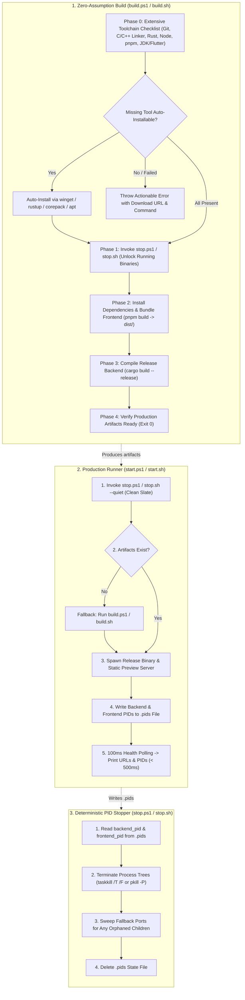

# Build, Start & Stop Script Separation Architecture

This document details the architectural mechanics, lifecycle phases, PID tracking protocol, and zero-assumption environment verification for Windows (`.ps1`) and Linux (`.sh`).

---

## 1. Why Start Must Run in Optimized Production Mode (Never Dev Mode)

In many full-stack setups, developers default to running development servers (`npm run dev`, `cargo run`, `flutter run`). In real-world applications, this severely degrades startup speed and runtime performance:

### The Flaws of Development Mode:
1. **Dynamic Transpilation Lag (The "Blank Screen" Problem)**:
   - Dev bundlers compile modules on demand as the browser requests them, causing a 5 to 15 second blank white screen on initial load.
2. **Unoptimized Execution (Debug Profile)**:
   - `cargo run` defaults to `opt-level = 0` with zero SIMD vectorization or inlining (running 20x–100x slower on compute workloads).
   - `flutter run` (debug) runs inside a JIT VM with checked assertions, causing frame drops on 120Hz displays.
3. **Orphaned Background Processes & File Locks**:
   - Without deterministic PID tracking (`.pids`) and a dedicated `stop` script, background processes linger on ports and lock `.exe` files on Windows (`OS Error 5: Access is denied`).

---

## 2. Three-Script Lifecycle Flow (`build` / `start` / `stop`)



---

## 3. Deterministic PID Tracking Protocol (`.pids`)

When `start.ps1` or `start.sh` launches the application:
1. It immediately captures the OS process ID (`PID`) of both the compiled backend binary and the frontend preview server.
2. It writes those PIDs to `<repo-root>/.pids`:
   - On Windows (`start.ps1`): JSON structure containing `backend_pid`, `frontend_pid`, `backend_port`, `frontend_port`, `started_at`.
   - On Linux (`start.sh`): Key-value shell env structure containing `BACKEND_PID`, `FRONTEND_PID`, `BACKEND_PORT`, `FRONTEND_PORT`, `STARTED_AT`.
3. When `stop.ps1` or `stop.sh` is executed (either manually by the user, by an AI agent after testing, by `build` before recompiling, or by the `Ctrl+C` trap in `start`):
   - It reads `.pids` first and kills the exact process trees for those PIDs.
   - It then performs a secondary port check and deletes `.pids`.

---

## 4. Reverse Proxy Connection Pooling (`vite.config.ts`)

In preview mode, Vite reverse-proxies API calls from `5173` to `8080`. Always configure an unbounded keep-alive agent in `frontend/vite.config.ts` to prevent socket exhaustion:

```typescript
import http from "node:http";
import { defineConfig } from "vite";
import solidPlugin from "vite-plugin-solid";

const keepAliveAgent = new http.Agent({
  keepAlive: true,
  maxSockets: Infinity,
  maxFreeSockets: 64,
  timeout: 30000,
});

export default defineConfig({
  plugins: [solidPlugin()],
  preview: {
    host: true,
    port: 5173,
    proxy: {
      "/api": {
        target: "http://127.0.0.1:8080",
        changeOrigin: true,
        agent: keepAliveAgent,
      },
    },
  },
});
```
